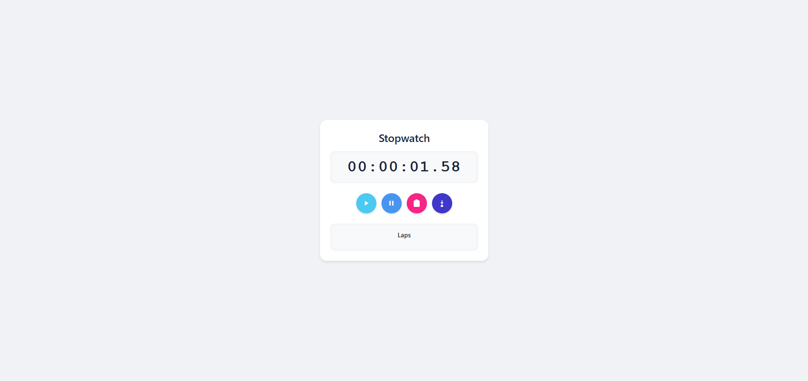
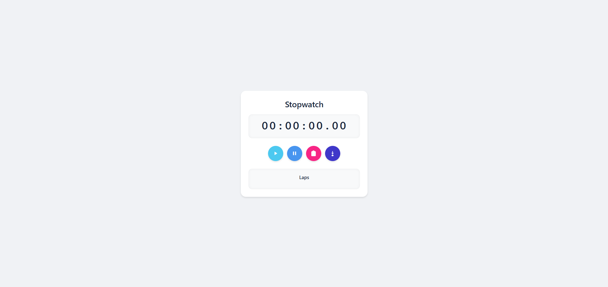

# Stopwatch Web Application

A simple, responsive stopwatch built with **HTML, CSS, and JavaScript**. It provides controls to start, pause, reset, and record lap times.

## Preview

### Stopwatch at the initial state


### Stopwatch while running


## Features

- Start and pause the stopwatch
- Reset the timer to `00:00:00.00`
- Record and display lap times
- Display elapsed time in hours, minutes, seconds, and hundredths of a second
- Simple, clean interface

## Built With

- HTML5
- CSS3
- JavaScript

## Project Structure

```text
Stopwatch-Web-Application/
├── index.html
├── styles.css
├── script.js
├── README.md
└── assets/
    ├── stopwatch-initial.png
    └── stopwatch-running.png
```

## Run Locally

1. Download or clone this repository.
2. Keep `index.html`, `styles.css`, and `script.js` in the same folder.
3. Open `index.html` in a web browser.

No server, database, or additional dependencies are required.

## How to Use

1. Select **Start** to begin timing.
2. Select **Pause** to temporarily stop the timer.
3. Select the lap button while the stopwatch is running to record a lap.
4. Select **Reset** to clear the timer and recorded laps.

## Repository

[Stopwatch-Web-Application on GitHub](https://github.com/mohitsingh40/Stopwatch-Web-Application)
